# STIRAMS Web

A web dashboard for managing employee attendance, schedules, and Daily Time Records at STI College Santa Rosa.

**Web** · **Institutional Project** · 2026

[Portfolio](https://kuraisler.xyz) · [Website demo](https://stiramsweb.vercel.app/)

## Purpose

STIRAMS Web turns RFID attendance records into information campus administrators can review and use for reporting. It is the management side of a two-part system: the Windows kiosk captures card taps, and the web dashboard manages people, schedules, exceptions, and reports.

## Intended users

HR personnel, campus administrators, and staff responsible for faculty and employee attendance at STI College Santa Rosa.

## Main capabilities

- Monitor attendance and review employee records, schedules, and recent activity.
- Generate Daily Time Records and export attendance reports.
- Manage leave requests, holidays, teaching schedules, and substitutions.
- Review attendance irregularities, verification requests, and audit history.

## How it was built

### Web application

Next.js App Router and TypeScript handle dashboard pages and server API routes; Tailwind CSS and Radix UI support the interface.

### Shared attendance data

Server-side PostgreSQL queries use the pg driver. The dashboard works with the same attendance data as the WPF client, which owns local offline capture and synchronization.

### Reporting and updates

SWR refreshes client data, Recharts visualizes attendance, and report routes assemble timesheets, exports, and email delivery.

## Technology stack

| Responsibility | Technologies |
| --- | --- |
| Web interface | Next.js 14, React 18, TypeScript, Tailwind CSS 4, Radix UI |
| Server & database | Next.js API Routes, PostgreSQL, pg |
| Data & reporting | SWR, Recharts, ExcelJS, Nodemailer |

## Project scope and current state

An institutional capstone and internship project for STI College Santa Rosa. The dashboard and kiosk are separate applications within one attendance system; a running dashboard requires its configured database and institutional settings.

## Source guide

- [`app/dashboard/`](app/dashboard/)
- [`app/api/`](app/api/)
- [`lib/`](lib/)
- [`package.json`](package.json)

## Development setup

Requires Node.js, npm, and a development PostgreSQL database with the matching institutional schema. Configure the database, authentication/session settings, and optional email services referenced by the server code. The WPF kiosk is a separate application.

```sh
npm install
npm run dev

# Production build
npm run build
```

## Screenshots

<table>
<tr>
<td align="center">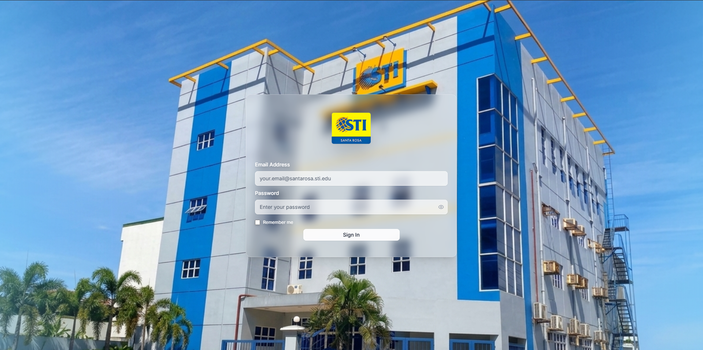<br>Secure entry point</td>
<td align="center">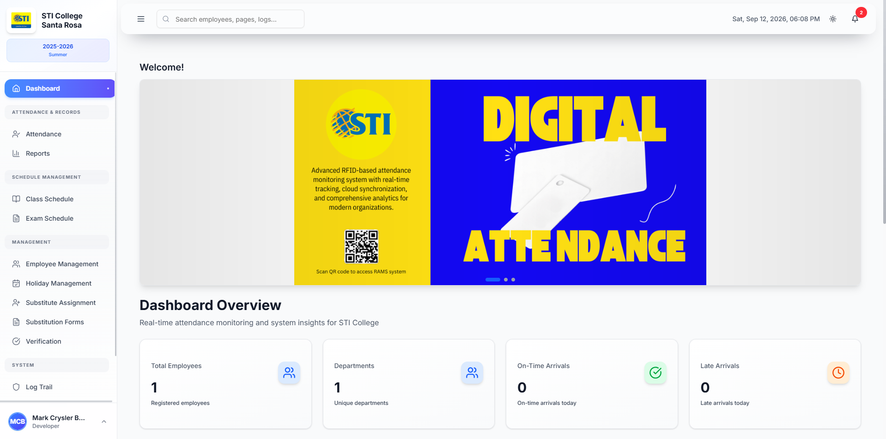<br>Daily briefing</td>
</tr>
</table>

<details>
<summary>View all 15 screenshots</summary>

### 1. Secure entry point


### 2. Daily briefing


### 3. Live attendance feed

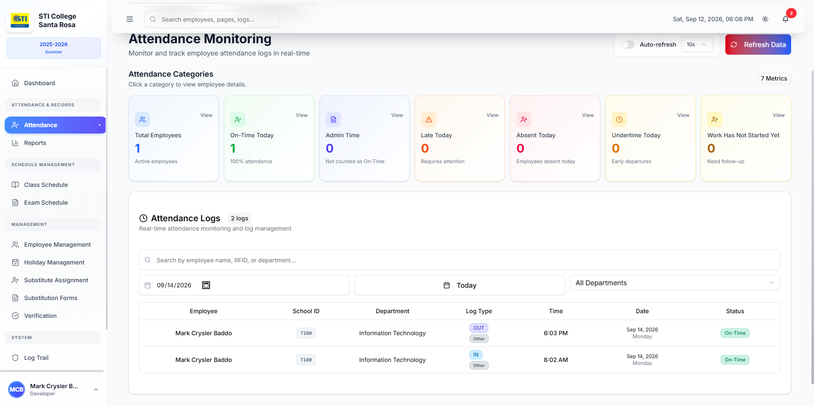

### 4. DTR generation center

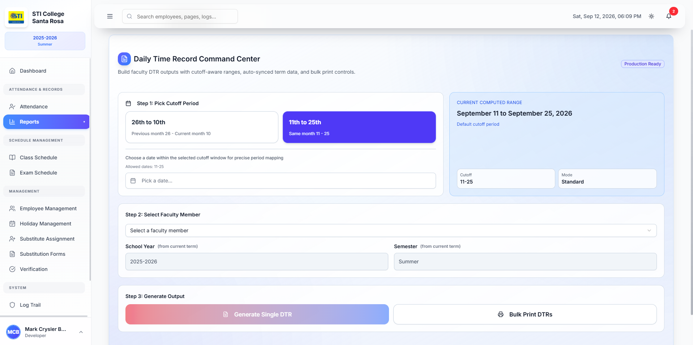

### 5. DTR preview

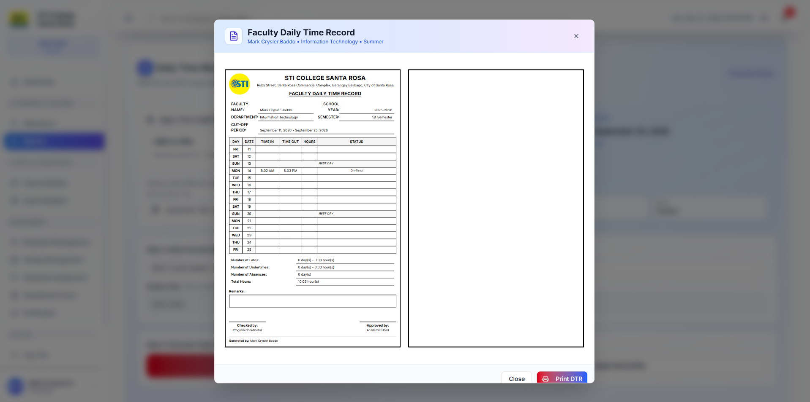

### 6. Class schedule builder

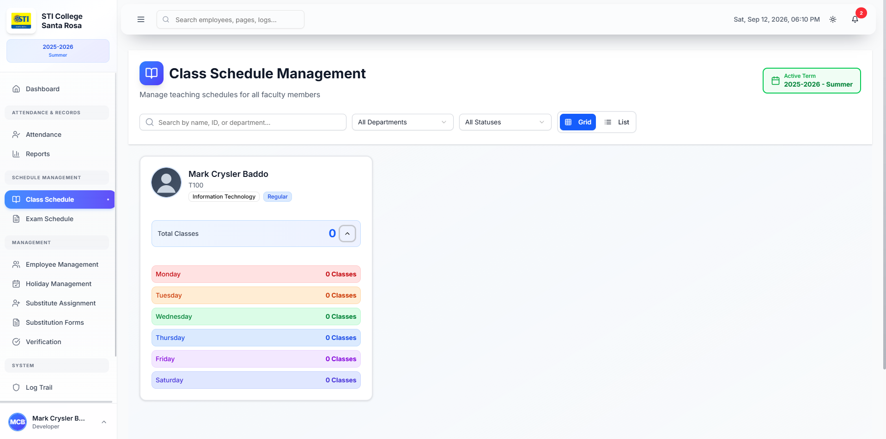

### 7. Exam schedule management

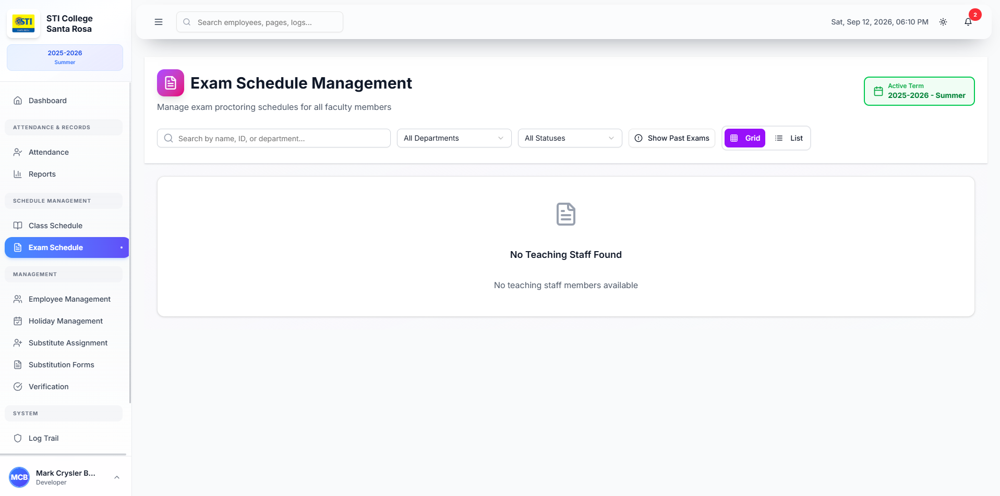

### 8. Employee directory

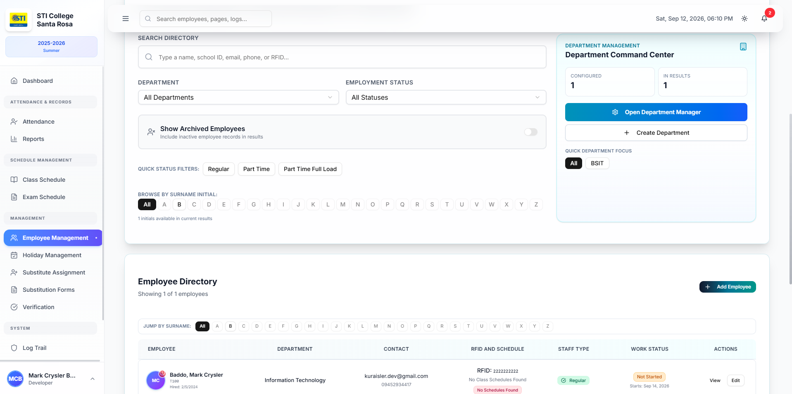

### 9. Holiday calendar

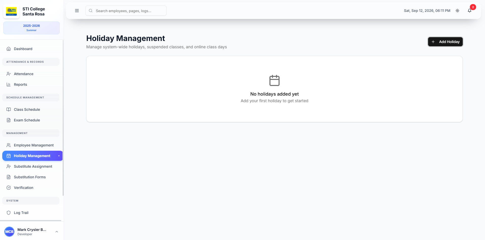

### 10. Substitution manager

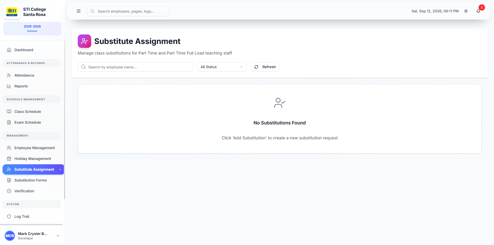

### 11. Substitution records

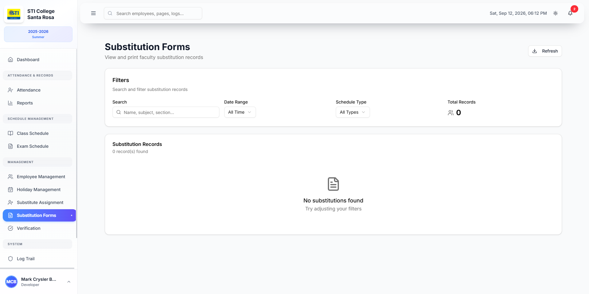

### 12. Leave verification

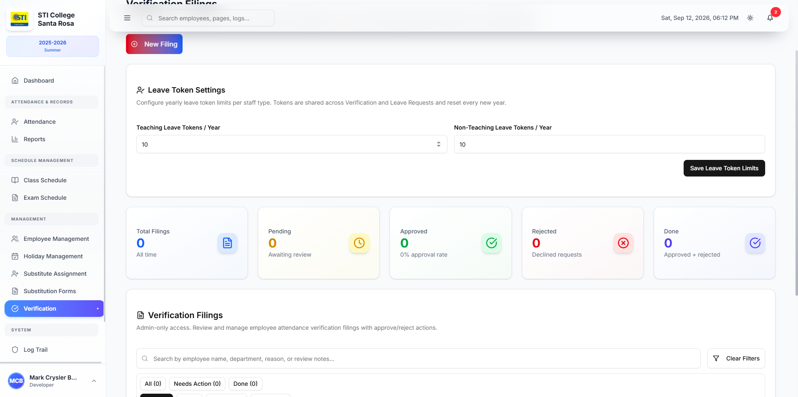

### 13. Audit trail

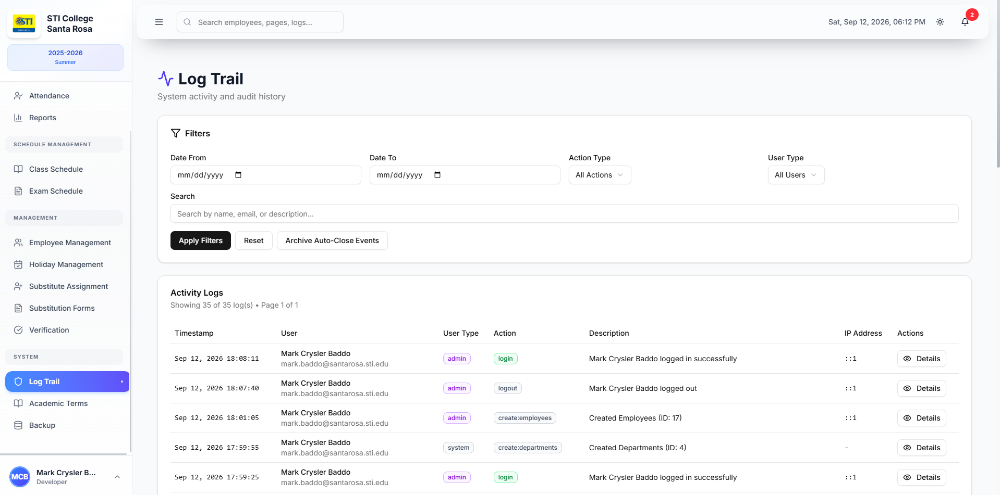

### 14. Academic term setup

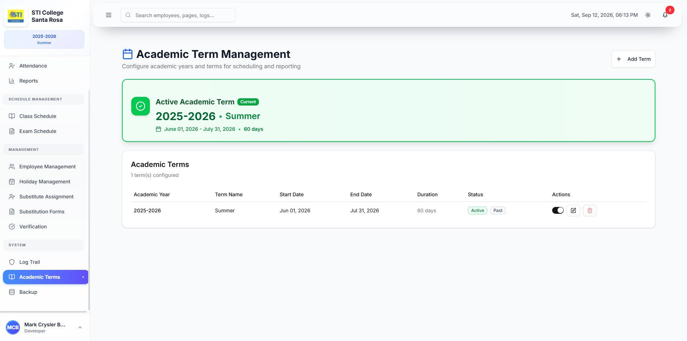

### 15. Database maintenance

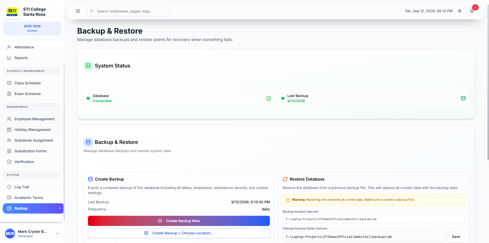

</details>

## License

See [LICENSE](LICENSE).

---

Project by [Mark Crysler Baddo](https://github.com/Kuraisura) · [Portfolio](https://kuraisler.xyz)
